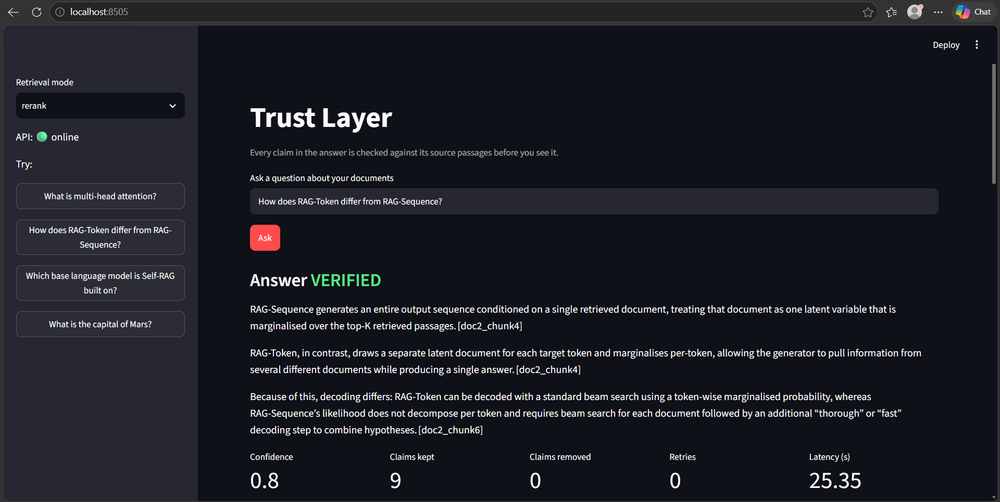
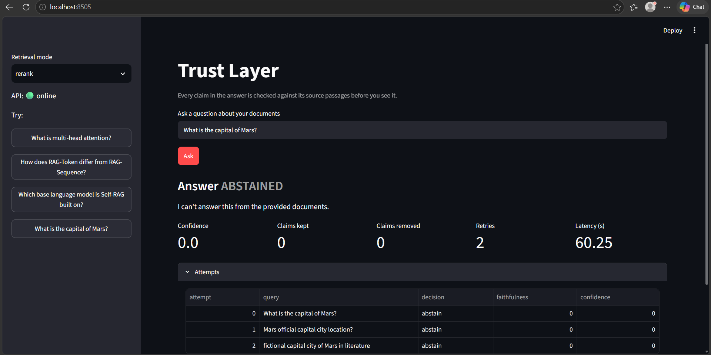

# Trust Layer

A RAG pipeline that checks its own answers. Every answer is split into atomic claims, and each claim is verified against the retrieved passages. Unsupported claims trigger a retry with a rewritten query. If they still fail, they are removed, or the system abstains instead of guessing.

```
Question
  -> hybrid retrieval (BM25 + dense, RRF fusion)  -> top 20
  -> cross-encoder reranker                       -> top 5
  -> answer generation (must cite passage IDs)
  -> claim extraction (answer -> atomic claims)
  -> claim verification (SUPPORTED / CONTRADICTED / NOT_ENOUGH_INFO)
  -> decision (LangGraph)
       all supported      -> return answer
       some unsupported   -> rewrite query, re-retrieve (max 2 loops)
       still unsupported  -> drop unsupported claims, or abstain
  -> answer + per-claim evidence + confidence
```

## Stack

Python 3.10 · LangGraph · ChromaDB · rank_bm25 · bge-small-en-v1.5 (embeddings) · bge-reranker-base (cross-encoder) · DeBERTa-v3 NLI (optional) · any OpenAI-compatible LLM (Groq, Ollama, OpenAI) · FastAPI · Streamlit · MLflow · Docker · GitHub Actions

## Quick start

```bash
python -m venv .venv && .venv\Scripts\activate      # Windows
pip install -r requirements-dev.txt
```

Create `.env` (never commit it):

```
LLM_BASE_URL=https://api.groq.com/openai/v1
LLM_API_KEY=<your key>
LLM_MODEL=openai/gpt-oss-120b
NLI_ENABLED=0
```

Put text-based PDFs in `data/raw/`, then:

```bash
python -m src.ingestion.ingest                        # parse, chunk, embed
python -m src.graph.rag_graph "What is multi-head attention?"
uvicorn src.api.main:app --port 8000                  # API at /docs
streamlit run app/streamlit_app.py                    # UI at :8501
pytest -q                                             # 27 tests, no API calls needed
```

Docker: `docker compose build`, then `docker compose run --rm api python -m src.ingestion.ingest`, then `docker compose up`.

## Evaluation

Gold set: 25 questions over 3 papers (Transformer, RAG, Self-RAG): 17 answerable and 8 unanswerable, including 4 near-misses that reuse the papers' vocabulary (e.g. "What BLEU did RAG get on WMT?"). Tracked in MLflow.

| Config | Answer accuracy | Abstain recall | False abstain | Unsupported claims / answer | Latency (s) |
|---|---|---|---|---|---|
| dense | 0.882 (15/17) | 1.0 (8/8) | 0.059 | 0.062 | 9.2 |
| hybrid | 0.941 (16/17) | 1.0 (8/8) | 0.059 | 0.0 | 8.9 |
| rerank | 0.882 (15/17) | 1.0 (8/8) | 0.118 | 0.0 | 17.5 |
| rerank + verify loop | 0.941 (16/17) | 1.0 (8/8) | 0.059 | 0.0 | 20.6 |

Citation validity was 1.0 in every config. Latency is from the first (uncached) run on a laptop CPU; the plain configs exclude the measurement-only verification pass.

**What the data supports**
- All 8 unanswerable questions were refused by every config, including the near-misses.
- Dense retrieval was the only config that showed an unsupported claim.
- The verification loop recovered a false abstain that plain reranking missed (the Self-RAG base model question, in an earlier run).

**What it does not support**
- The differences between configs are 1 to 2 questions out of 17, which is within noise. This evaluation does not show that hybrid beats rerank, or the reverse.

## Latency: NLI vs. judge-only

Claims are verified either by a local DeBERTa NLI model first (the LLM judge only for uncertain claims), or by the LLM judge alone (`NLI_ENABLED=0`).

| Mode | Per question (my CPU) | Eval accuracy / abstain recall |
|---|---|---|
| NLI + judge | 114.6 s (157 s via API) | 1.0 / 1.0 (15-question set) |
| Judge only | 30.2 s (18.7 s via API) | 1.0 / 1.0 (15-question set) |

On a slow CPU, local NLI dominated the cost (about 13 s per claim). Judge-only is the default. NLI-first is worth enabling on faster hardware, or where API calls are expensive.

## Known limitations

- **Small gold set.** 25 questions and 3 papers. The gold keys are keyword matches, so correct but differently worded answers can be scored wrong. I fixed two such keys while auditing (q02, q21).
- **Source inconsistency.** The Transformer paper reports 41.8 BLEU (EN-FR) in the abstract and table, but 41.0 in one body sentence. The gold set accepts either.
- **Circular faithfulness.** The verifier that filters claims also scores them, so `rerank + verify` reporting 0 unsupported claims is true by construction. Faithfulness for the baselines is also judge-based. A human or independent-judge check is still needed.
- **Retrieval limits.** A question phrased differently from the paper ("base language model" vs "generator LM") can miss its evidence. The retry loop rescued one such question in one run and not in the final run. Retrieval is the bottleneck, not generation.
- **Single-run results.** No repeated runs or confidence intervals.
- **Cost of retries.** Unanswerable questions run up to 3 retrieval attempts before abstaining, so they are slower than answerable ones.
- **Text PDFs only.** Scanned documents would need OCR.

## Repo layout

```
src/ingestion/     load, clean, chunk (500 tokens, 50 overlap), embed
src/retrieval/     bm25, dense, hybrid (RRF), reranker, search
src/generation/    answer prompt, citation parsing, query rewriter
src/verification/  claim extractor, verifier (NLI + LLM judge), scorer, finalize
src/graph/         LangGraph state, nodes, pipeline
src/api/           FastAPI service
app/               Streamlit demo
evaluation/        metrics, ablations, runner (MLflow)
data/eval/         gold questions
```

## Demo




